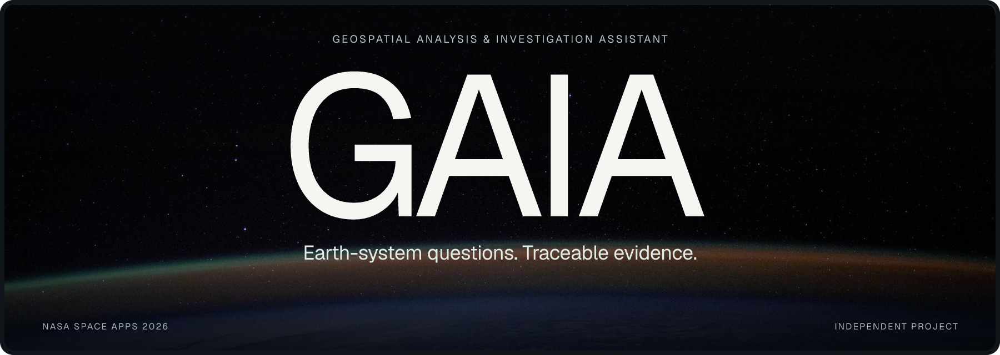

# GAIA

**Geospatial Analysis & Investigation Assistant**

GAIA helps people investigate environmental change using NASA data, reproducible numerical analysis and source-backed explanations. Ask a question in ordinary language; GAIA coordinates the relevant work and returns an answer whose measurements, methods, uncertainty and limitations can be inspected.

Built for **NASA Space Apps 2026 — [Be An Earth System Trend Detective!](https://www.spaceappschallenge.org/2026/challenges/earth-system-trend-detective/)**.

**[Presentation](docs/submission/gaia-seven-slide-presentation.pdf)** · **[Worked investigation](docs/submission/bc-central-interior-report.md)** · **[Reproducible evidence](docs/submission/bc-central-interior-investigation.json.gz)** · **[Run locally](#run-locally)**

## Why GAIA?

A satellite trend is a starting point, not an explanation. Greenness, weather, water and ecological observations describe different parts of the Earth system—and often cover different places, dates and scales. Connecting them responsibly requires more than finding a paper or drawing a trend line.

GAIA brings that investigation into one workspace:

- **Real data, not generated measurements.** Supported acquisitions retrieve provider data; registered Python methods compute the numerical results.
- **Connected perspectives.** GAIA selects relevant atmospheric, water, plant and animal specialist functions instead of treating one variable as the whole ecosystem.
- **Evidence you can inspect.** Series, quality checks, source records, methods and uncertainty remain connected to the investigation.
- **An honest answer when evidence is insufficient.** Missing observations, failed requests and unsupported capabilities remain visible. A literature-only explanation is not labelled a measured trend.

## From a question to an investigation

1. **Define the question.** GAIA identifies the place, period and outcome, asking for clarification when an ambiguity would materially change the investigation.
2. **Find suitable evidence.** It resolves real locations or boundaries, checks available methods and acquires supported datasets. A fixed satellite footprint is not silently substituted for a region.
3. **Analyze in code.** The scientific worker applies product-specific quality rules and registered trend methods, preserving observation dates, units and missing periods.
4. **Review competing explanations.** Relevant specialists examine support, source dependence, mechanisms and unresolved gaps. Literature informs interpretation without becoming a substitute for measurements.
5. **Explain and preserve the result.** The conversation presents the findings; evidence, research and investigation-record views expose the supporting work and exports.

The user talks to **GAIA** throughout. Specialist workspaces are read-only extensions of that investigation, not four additional chatbots to manage.

| Function | Investigation perspective |
|---|---|
| **GAIA** | Coordinates the question, evidence acquisition, specialist work and final synthesis. |
| **AURA** | Atmospheric conditions, climate context and the limits of meteorological support. |
| **THALASSA** | Water processes, compatible hydrologic evidence and physical accounting. |
| **CHLORIS** | Vegetation signals, satellite quality, seasonal support and plant-evidence interpretation. |
| **ZOE** | Animal occurrence, observation effort and the distinction between presence and population change. |

These are bounded software functions, not independently validated scientific experts. Their available measurements are limited by the integrations below.

## NASA data and observation imports

| Source | Implemented acquisition | What it represents |
|---|---|---|
| **[NASA POWER](https://power.larc.nasa.gov/docs/services/api/temporal/monthly/)** | Monthly temperature, precipitation rate and relative humidity for an owned location. | MERRA-2 model-grid context at a point—not a local station or an arbitrary regional mean. |
| **[MODIS / ORNL DAAC TESViS](https://modis.ornl.gov/data/modis_webservice.html)** | EVI and quality information for a provider-listed, fixed satellite footprint. | Terrestrial optical greenness over that footprint—not every surrounding landscape. |
| **[NASA AppEEARS](https://appeears.earthdatacloud.nasa.gov/)** | Monthly **MOD13A3.061 EVI or NDVI plus QA** over an owned polygon, with authenticated submission, task tracking, collection and checksummed files. | Regional landscape greenness—not biomass, biodiversity or forest-only change without an appropriate mask. |
| **CSV import** | User-supplied observations with declared units, source and spatial support. | Provenance and QA are user-declared, not automatically authenticated; users must check licensing before redistribution. |

AppEEARS is an asynchronous extraction service. An accepted task is **pending work, not numerical evidence**. GAIA retains the original task, waits for collection, retries transient transport failures and distinguishes a paused wait from a genuine provider failure. Regional processing retains source geometry, audits topology preparation and checks spatial membership on the provider grid before publishing values.

NOAA integration currently discovers nearby **station metadata**, not historical station measurements. Giovanni, CUAHSI and KNMI are documented discovery/manual-import routes. Automatic sea-ice extent and GRACE/GRACE-FO ice-sheet mass adapters are **not yet implemented**.

## A worked result: British Columbia's Central Interior

The included investigation demonstrates a completed acquisition and an appropriately qualified answer—not a hand-picked significant trend.

- **Eight numerical artifacts** are retained: regional monthly and seasonal EVI, three monthly POWER variables and their three seasonal derivatives.
- The study uses the documented **Central Interior ecoprovince** boundary, not every interpretation of “Interior Plateau.”
- After the declared 80% QA-valid-area rule, monthly EVI retained **101 valid observations and 187 missing months** over 2001–2024. The monthly trend was therefore **inconclusive**.
- The exploratory July–September EVI series had **21 complete seasons and three missing seasons**. Its result is descriptive-only; no unsupported inferential interval or p-value is presented.
- Weather context does not establish forest decline or its cause. A compatible forest mask and matched disturbance evidence remain material gaps.

The value is the traceable result: **what was acquired, what survived quality checks, what can be concluded and what evidence is still needed.**

Read the **[full report](docs/submission/bc-central-interior-report.md)** or download the **[complete evidence archive](docs/submission/bc-central-interior-investigation.json.gz)**. Both are accessible without a model-provider account. Additional public examples cover [POWER climate context](docs/examples/british-columbia.json) and a [MODIS prairie footprint](docs/examples/modis-prairie.json).

## Built for inspectable science

**Language models coordinate and explain; deterministic code computes.** GAIA uses the embedded OpenCode runtime for role-bound model sessions and tools, while a separate Python worker retrieves and analyzes scientific data. Jev is an optional, opt-in typed semantic review in shadow mode; it does not override measurements or establish scientific truth. A disabled review, missing TypeSafe credential, oversized review or service failure is recorded without discarding scientific results or stopping the investigation.

For eligible complete monthly records, the registered trend method uses a linear slope with calendar-month effects and Bartlett/Newey–West uncertainty. Default conventions are a 12-month bandwidth, 6/24-month sensitivity checks, nominal 95% intervals and a two-sided 0.05 threshold. Seasonal and incomplete-calendar recipes have separate eligibility rules. Missing periods are not compressed into a false continuous record, and insufficient evidence cannot silently receive a definitive significance claim.

Exports retain analysis inputs, source provenance and method hashes. The reproduction command reruns numerical analyses in an independent local process without model credentials or renewed downloads; it does not regenerate model-written prose.

**A significant association is not a verified cause. A nonsignificant result is not proof of no change.**

## Run locally

**Verified platform:** Windows x64 with Git and Python 3.13 available on `PATH`, plus Node 24+ and npm 10+ to start setup. Setup provisions the project-local Node 26.13.1 used by the application. The primary interface is a Rust/WASM **Rune** workspace and requires a WebGPU-capable browser, verified in Chromium. Other platforms and a WebGL fallback are not verified.

```powershell
git clone https://github.com/KiritoBloom/GAIA.git
cd GAIA
npm run setup
npm run dev
```

Open **[http://127.0.0.1:4317/rune/](http://127.0.0.1:4317/rune/)**.

Setup installs dependencies, builds the frontend and provisions checksum-verified portable Node 26.13.1 plus the project-local Rust/WASM toolchain. The first build can take several minutes. Runtime state, installation caches and the Python environment stay inside the project; setup does not replace the system toolchain or perform global npm/pip installs.

### Connect a model

1. Open **Settings**. Models are discovered automatically from the connected provider or private local configuration. For a new connection, choose OpenAI Responses, OpenAI Chat/compatible, or Anthropic Messages and enter a masked API key; custom base URLs are available under **Connection details**.
2. Search/select an actual model, choose a published thinking option or leave **Provider default**, then **Connect**. Official endpoints use native OpenAI or Anthropic clients; custom endpoints use the selected protocol. Discovery does not switch a running investigation’s provider.
3. Ask an environmental question with a place and period. Inspect **Evidence**, **Research** and **Investigation record** as the work progresses.

The synthetic role/tool check is optional and verifies integration, not scientific expertise. Provider calls may incur charges. A selected provider key is held by the local backend, not persisted in browser storage, chat or exports; restarting clears the active provider selection.

**Jev is off by default and requires no account to run GAIA.** Its Settings switch becomes available with a private `TYPESAFE_API_KEY` or `TYPESAFE_KEY`. Enabling it sends the bounded review context to TypeSafe; results remain separate from scientific calculations. Higher model-thinking settings may increase latency and cost, and published upstream options are not a guarantee of compatibility at every custom gateway.

Public POWER and TESViS access require no additional API key. Regional AppEEARS extraction requires Earthdata Login credentials supplied privately as `APPEEARS_USERNAME` and `APPEEARS_PASSWORD`; never paste them into a conversation. Optional private configuration belongs in an ignored `.env`, with general examples in [`.env.example`](.env.example).

**Local-first is not offline.** Selected model providers receive prompts and external data services receive acquisition requests. This is a single-user loopback application, not a hardened public hosting service.

## Verify the implementation and reproduce the evidence

```powershell
# Run the existing Python and Node tests.
npm test

# Rebuild the Rune frontend.
npm run build

# Reproduce all eight published BC artifact analyses without provider/network access.
npm run reproduce -- docs/submission/bc-central-interior-investigation.json.gz
```

The recorded verification includes **42 Python tests and 53 Node tests**, a successful Rune build, and reproduction of the eight published analyses with matching input/method hashes and a declared `1e-10` numerical tolerance. Coverage includes ownership, provenance, calendar integrity, quality rules, units, source quotations, provider security and runtime lifecycle. Build/test success is not independent ecological validation.

`npm run test:runtime` optionally exercises real model-role/tool round trips using a private configured provider. It makes billable provider requests and is separate from numerical reproduction. The recorded live provider run used an OpenAI-compatible endpoint; native OpenAI/Anthropic routing and thinking options were checked against the installed SDK and controlled discovery fixtures, not verified with live accounts for every provider/model combination.

## Architecture

| Location | Responsibility |
|---|---|
| [`app/rune`](app/rune) | Rust/WASM GPU interface: conversation, evidence, research, specialist workspaces and live activity. |
| [`app/backend`](app/backend) | Local HTTP/SSE service, embedded OpenCode sessions, scientific access controls, application-owned acquisition waits and worker-backed persistence. |
| [`science`](science) | Provider adapters, QA, geometry validation, numerical methods, diagnostics and reproduction inputs. |
| [`skills`](skills) | Versioned investigation and domain procedures. |
| [`docs/submission`](docs/submission) | Presentation, worked report and complete reproducible evidence. |

The earlier React interface remains a legacy implementation; Rune is the primary submitted workspace.

## Current boundaries

- Numerical coverage is **not universal**. An unsupported ice, animal, water or regional question must expose the missing capability rather than substitute unrelated data.
- Different spatial footprints, time windows, sensors and derived series are not automatically independent or matched evidence.
- Optical greenness is not yield, mortality, species identity, abundance or ecological recovery. Animal occurrences are not population counts.
- Causal attribution, general ecological expertise, research-ready forecasts and autonomous interventions are not established. Several proposed simulation families remain explicitly unavailable.
- Sensitive coordinates, licensed observations and private investigation material require review before redistribution. An export is not permission to publish everything it contains.

## License and acknowledgements

GAIA is an independent participant project, **not NASA-endorsed**. Source code is [MIT licensed](LICENSE); third-party software and datasets retain their own licenses and attribution requirements.

Built with Rune/rune-kit, OpenCode, NumPy, SciPy, pandas, statsmodels, netCDF4 and Shapely. Statistical foundations include [Newey & West (1987)](https://doi.org/10.2307/1913610). The main-content Geist font is distributed under the [SIL Open Font License](artifacts/fonts/OFL.txt).

Code, interface and identity work used AI assistance. Numerical observations come from identified data providers, not image or language generation. Banner photograph: [NASA/JSC, ISS072-E-724819](https://images.nasa.gov/details/iss072e724819), used as illustration—not an analyzed dataset or an endorsement. See the [original GAIA identity](artifacts/logos/README.md) and [banner source credits](docs/assets/README.md).
